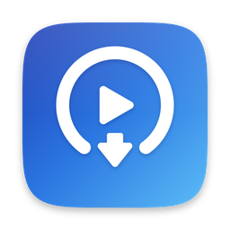

<p align="center">
  
</p>

<h1 align="center">Jukto</h1>

<p align="center">
  A small, fast, native macOS video downloader. A clean SwiftUI front-end for <a href="https://github.com/yt-dlp/yt-dlp">yt-dlp</a>.<br>
  No tracking · no accounts · no automatic updates.
</p>

---

## Features

- **Paste a link, press Download.** Jukto reads the clipboard (can be turned off) and analyzes links automatically.
- **Up to the maximum resolution** the site offers, including 4K and 8K. MP4, MOV, WebM or MP3.
- **Frame-accurate trimming.** Download only the part you need; the clip is cut cleanly with no blank tail.
- **Light on the CPU.** Streams are merged without re-encoding. The only conversion is the constant-frame-rate fix, and it runs only on files that really have a variable frame rate.
- **Subtitles, extra audio tracks and cover art** (embedded or as separate files).
- **Capture browser** for sites yt-dlp can't read on its own. DRM-protected streams are detected and refused.
- **Menu-bar status** with progress, a completion sound and a notification.
- **Light and dark.** A minimal day/night switch in the window corner and in Settings.
- **Private.** Jukto collects nothing and sends nothing anywhere. Site sign-ins are kept in your Keychain.
- **Universal.** Separate builds for Apple Silicon and Intel Macs; macOS 14 or newer.

## Install

1. Download the disk image for your Mac from the [Releases](../../releases) page:
   - `Jukto-1.0.3-AppleSilicon.dmg` — M1 / M2 / M3 / M4 Macs
   - `Jukto-1.0.3-Intel.dmg` — Intel Macs
2. Open it and drag **Jukto** into **Applications**.
3. First launch: the app is not notarized, so macOS asks for confirmation. Open **System Settings → Privacy & Security**, scroll down and press **Open Anyway**. Or run once in Terminal:
   ```bash
   xattr -cr /Applications/Jukto.app
   ```

Not sure which Mac you have? Apple menu → **About This Mac**: "Chip: Apple M…" means Apple Silicon, "Processor: Intel…" means Intel.

## Updates

Jukto never checks for updates on its own. When you want fresh `yt-dlp` / `ffmpeg` components (sites change often), click **yt-dlp** in the footer or use **Settings → Check for Updates**. Downloads go over HTTPS, are verified against the publisher's SHA-256 and self-tested before use. The same click also looks for a newer Jukto on this repository's [Releases](../../releases) page and downloads the disk image for your Mac.

## Build from source

Requirements: macOS 14+, full Xcode, [XcodeGen](https://github.com/yonaskolb/XcodeGen).

```bash
brew install xcodegen
git clone https://github.com/<your-username>/Jukto.git
cd Jukto
./scripts/make-release.sh
```

This downloads and verifies the bundled components, builds the app and puts `Jukto-1.0.3-AppleSilicon.dmg` and `Jukto-1.0.3-Intel.dmg` on your Desktop. For a quick development build:

```bash
./scripts/fetch-binaries.sh && xcodegen generate && open Jukto.xcodeproj
```

## Responsible use

Jukto is a tool for saving videos you have the right to save: your own, public-domain, Creative Commons, or where the owner or the site's terms allow it. You are responsible for how you use it. It does not and will not bypass DRM.

## Credits

Built on [yt-dlp](https://github.com/yt-dlp/yt-dlp), [FFmpeg](https://ffmpeg.org) and [Deno](https://deno.com). See [THIRD_PARTY_NOTICES.md](THIRD_PARTY_NOTICES.md).

Made by [@asan_djantaliev](https://t.me/+z179h3EA99M3NDli).

## License

[MIT](LICENSE) for Jukto's own source code. The bundled components keep their own licenses.
